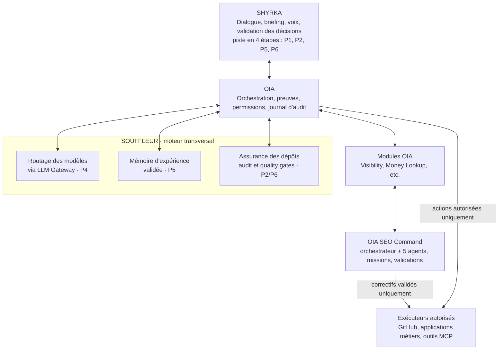
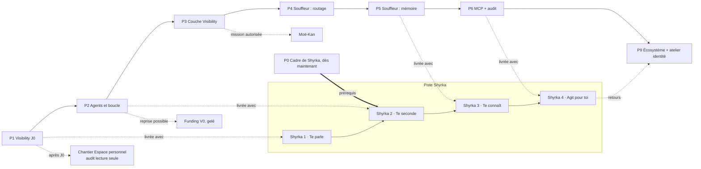

# OIA × Shyrka × Souffleur – Roadmap consolidée

7 novembre 2026 · Mickaël Thomas

| Champ | Valeur |
| --- | --- |
| Version | 3.11 |
| Dernière modification | 2026-11-08 |
| Statut | Proposé (à valider par Mickaël) |
| Responsable | Mickaël Thomas |
| Référence | `docs/roadmap-oia-shyrka-souffleur.md`, unique source de vérité ; l'historique détaillé est celui de git |

**Décisions approuvées par Mickaël**

- Elmo collecteur de transition, en mode API payant : **accord de principe et plafond de 30 $ par mois validés**. La mise en œuvre technique se fait à l'étape B de P1 ; les dépenses réelles commencent seulement à l'étape D, avec la création des comptes par Mickaël. Toute autre dépense est validée au cas par cas.
- Collecteur maison en cible, remplacement progressif moteur par moteur.
- Pilotes de départ : Coach Gari et Maisons.co ; Moë-Kan comme premier client externe envisagé.
- J0 sur cinq moteurs : ChatGPT, Claude et Mistral en direct ; Gemini et Perplexity via OpenRouter. Grok reporté à une fenêtre ultérieure, avec sa propre mesure de départ.
- La branche Lovable (`lovable/oia-visibility-prototype`) est autorisée, sous les règles du dépôt : elle appartient à Lovable ; Claude Code ne la modifie pas, n'en copie et n'en exporte aucun fichier.
- Shyrka v0, décidée par Mickaël le 7 novembre 2026 : présence en points et voix Aurélie, voix en sortie comprise (`docs/shyrka/CADRE.md`).
- Outil générique : aucun sujet, projet ou client codé en dur.
- OIA Visibility comme nom de travail ; Shyrka comme nom interne.
- Mistral retenu dans OIA pour son coût ; agents de développement dans Claude Code.
- OIA Funding V0 gelé en l'état, sans régression.
- **Lovable possède l'interface ; Claude Code possède les données, les calculs, la sécurité et l'architecture.** Claude Code ne modifie, ne copie et n'exporte aucun fichier du projet Lovable. Le lien entre les deux est un contrat de données versionné par module (`docs/interface/contrat-donnees-*.md`). Le bloc F du mandat v7 et le bloc C2 du mandat v6 sont annulés.
- **Money Lookup remplace Funding, Tenders, Ventures et Signals comme module** : un seul module pour les financements, les appels d'offres, les investisseurs et les signaux, avec une typologie financière obligatoire et aucun total qui mélange les catégories.
- Une seule roadmap éditable : ce fichier. Le Claude Doc et la carte OIA en sont des copies de lecture.
- Trois identités : **OIA Visibility** (le produit), **OIA SEO Command** (son centre opérationnel : six agents, missions planifiées, recommandations, validations ; principal différenciateur commercial), **Shyrka** (l'interface générale, qui pourra lui confier des missions).
- Intégration hybride des moteurs open source : Elmo, CrawlSEO et Crawlie utilisés derrière des adaptateurs OIA, sans copie de leur code ; une seule interface utilisateur, OIA Visibility ; appropriation sélective du code seulement après une preuve d'intérêt.

**Historique des changements**

| Version | Date | Changement |
| --- | --- | --- |
| 1 | 2026-11-07 | Roadmaps Claude et GPT rédigées séparément |
| 2 | 2026-11-07 | Consolidation, place de Souffleur (routage, mémoire, audit) |
| 3 | 2026-11-07 | P0 hors de la chaîne, formulations affirmatives, fichier de référence unique |
| 3.1 | 2026-11-07 | Gouvernance du document, P0 prérequis explicite de P7 |
| 3.2 | 2026-11-07 | Sens des flèches Funding et Moë-Kan, accord de principe distingué de l'autorisation de dépense, critères de bascule du collecteur maison |
| 3.3 | 2026-11-07 | OIA SEO Command rétabli comme centre opérationnel de Visibility, stratégie d'intégration des moteurs open source |
| 3.4 | 2026-11-07 | Cadre de Shyrka (CADRE.md) remplace la doctrine, P8 reçoit Ollama local + présence + identité évolutive, P9 reçoit l'atelier d'identité, chantier Espace personnel ajouté après J0, P6 constate l'absence de MCP existant et part de zéro |
| 3.5 | 2026-11-07 | P4 : Bifrost ajouté aux passerelles candidates, versions épinglées et audit de la chaîne d'approvisionnement avant toute installation |
| 3.6 | 2026-11-08 | Piste Shyrka en quatre étapes, chacune livrée avec une phase : Shyrka 1 « Te parle » avec P1, Shyrka 2 « Te seconde » avec P2, Shyrka 3 « Te connaît » avec P5, Shyrka 4 « Agit pour toi » avec P6. **P7 et P8 cessent d'être des phases** : Shyrka n'attend plus la fin de la chaîne pour exister, elle grandit avec les capacités qu'elle utilise. Le contenu de P7 (digest, dialogue, préparation) passe dans Shyrka 2 et Shyrka 3 ; celui de P8 (son local, Ollama) dans Shyrka 1, la présence et l'identité dans l'atelier de P9, la voix distante payante en attente. **P1 à P6 et P9 gardent leur numéro et leur contenu** ; les numéros 7 et 8 ne sont pas réattribués, pour que les références existantes (rapports, mandats, commits) restent justes. P0 validée devient le prérequis de Shyrka 2 à 4. Points des mandats v6 et v7 : Shyrka 1 livrée en code à adaptateurs (`packages/shyrka`), interface web sous `/oia` bascule éteinte, évaluation documentaire de Bifrost (`docs/audits/2026-11-08-bifrost-evaluation.md`) |
| 3.7 | 2026-11-08 | Décision de Mickaël (CADRE.md) : l'apparence, la voix et la personnalité de Shyrka sont choisies et modifiées par Shyrka elle-même. La piste Shyrka, P0 et l'atelier de P9 sont alignés |
| 3.8 | 2026-11-08 | Réponses de Mickaël et suite des mandats v6 et v7. Interface web OIA refaite d'après le prototype Lovable (colonne des modules, accueil, Visibility, Shyrka en panneau et en plein écran, pages existantes réutilisées), allumée en Preview Vercel seulement. Shyrka : Ollama `qwen3:8b` par défaut et `mistral-small` en comparaison ; bloc B livré en code simulé (paliers de permission, agent courrier et WhatsApp, mode entretien) ; Aurélie devient une proposition de départ. Blocs C et E du mandat v6 non traités : leur texte n'est pas dans le dépôt |
| 3.9 | 2026-11-08 | Clôture des mandats v6 et v7 (session web), avec l'amendement du 7 novembre. Décisions : J0 sur cinq moteurs avec OpenRouter, Grok reporté, branche Lovable autorisée sous les règles du dépôt, Shyrka v0 décidée par Mickaël (présence en points et voix Aurélie). Piste Shyrka v0 avancée : voix locale, entretiens, courrier en brouillons, WhatsApp professionnel cadré, paliers de permission. Règle d'intégration des moteurs reformulée en règle proposée, modifiable par Mickaël, qui autorise un fork documenté après preuve d'intérêt. Navigation de la console en proposition (`docs/interface/integration-console.md`). P1 : J0 en cours, rapport attendu. P2 : correctifs préparés, en attente de validation. Chantier « Interface web OIA » : nouvelle console sous `/oia`, en Preview, bascule en attente de Mickaël |
| 3.10 | 2026-11-08 | Mandat v8. Principe : Lovable pour l'interface, Claude Code pour les données ; interface `/oia` retirée, console d'origine rétablie à l'identique, `packages/ui-tokens` retiré. Money Lookup remplace Funding, Tenders, Ventures et Signals comme module : audit des données (A0), migrations 0003 à 0005 à relire, vues par écran, chargeur idempotent, reprise du travail du navigateur. Visibility : contrat de données, vues 0006, démonstration fictive ; constat bloquant sur `vis` 0004 pour Supabase. Piste Shyrka autonome : ADR 0003, noyau simulé (`packages/shyrka`), contrat de la zone Contexte. Voix Aurélie en sortie dans la version 0, alignée partout. Rien n'est appliqué en production |
| 3.11 | 2026-11-08 | Décisions de Mickaël : la base Supabase d'OIA lui est réservée (la copie de BEAU en est retirée), pas de projet séparé ; migration `0002a` qui réserve les tables aux comptes de Mickaël, à appliquer maintenant, sans changer la console ; la console garde son stockage local et `0003` attend l'application Lovable ; `0002` rangée comme migration de départ, `0001` archivée ; réseaux sociaux alignés sur la liste de Visibility ; sentiment, position et échecs de collecte en version 2 du contrat Visibility, après J0 |

> Emplacement de référence : `docs/roadmap-oia-shyrka-souffleur.md` dans le repo OolalaDXB/OIA. Toute autre copie (Claude Doc, export GPT) est une copie de lecture. `docs/roadmap.md` reste la roadmap d'OIA Funding.

OIA reste le système d'intelligence, de preuves et de permissions. **Souffleur** est le moteur transversal qui assure trois fonctions complémentaires : **routage des modèles, mémoire d'expérience et audit des dépôts**. **Shyrka** est l'interface de commandement qui dialogue avec l'utilisateur et prépare les actions. **Shyrka parle, Souffleur travaille, OIA prouve et contrôle.** Huit phases (P0 à P6, puis P9) avancent par portes de validation ; la piste Shyrka les accompagne en quatre étapes, chacune livrée avec une phase. Le cadre de Shyrka (P0) peut avancer immédiatement ; validé, il ouvre Shyrka 2 à 4. Cette roadmap consolide les deux versions du 7 novembre 2026 ; depuis la 3.6, les numéros 7 et 8 ne désignent plus de phase.

## Architecture cible

**Frontière des responsabilités :** Souffleur analyse, route, capitalise et audite ; OIA applique l'identité, les permissions, la provenance et les décisions ; Shyrka présente et sollicite les validations. Le serveur MCP expose des capacités limitées sans contourner OIA.

Shyrka est la couche du dessus, posée sur l'ensemble des modules. Souffleur est le moteur transversal qui travaille pour tous les outils. Shyrka utilise les fonctions de Souffleur via le socle OIA ; les systèmes métiers exécutent exclusivement sous permission.

## La roadmap

**Parallèle :** maintien de Funding V0 jusqu'à la mise en service de Money Lookup, étude Moë-Kan et audit technique Maisons.co, selon les conditions définies ci-dessous. Le prototype vocal local et Ollama sont devenus Shyrka 1, livrée avec P1.

Les phases avancent par portes, sans calendrier fixe : une phase démarre quand la précédente a franchi la sienne. Une étape Shyrka se livre avec sa phase et a sa propre porte ; elle ne retarde jamais la porte de la phase. Le cadre (P0) avance à tout moment ; P0 validée est un prérequis obligatoire de Shyrka 2 à 4, sans jamais retarder P1 à P6.

## Principes non négociables

Shyrka interroge, explique et propose ; OIA conserve les preuves et les permissions ; les systèmes métiers exécutent les opérations autorisées.

- **Preuves :** une donnée extraite reste « extraite » jusqu'à validation ; chaque recommandation importante est reliée à ses preuves.
- **Cloisonnement :** les connaissances sont séparées par utilisateur, projet et client ; une expérience ne devient règle partagée qu'après validation.
- **Autorité :** toute opération externe engageante exige une autorisation explicite de Mickaël.
- **Interchangeabilité :** modèles, fournisseurs et collecteurs restent remplaçables derrière une interface.
- **Coûts :** chaque dépense est validée avant engagement, plafonnée, observable et coupée automatiquement au plafond.
- **Non-régression :** aucun déploiement ne compromet Funding V0 ni les mesures de référence de Visibility.
- **Restauration :** pouvoir restaurer données et secrets est un critère de livraison.
- **Généricité :** aucun projet, sujet ou client codé en dur.
- **Mesures séparées :** aucun score composite unique ne masque les limites des métriques.

## Niveaux d'action de Shyrka

Quatre niveaux, du plus libre au plus encadré ; aucune capacité d'engagement n'est activée par défaut.

| Niveau | Exemples | Autorisation |
| --- | --- | --- |
| Observation | Lire un rapport, chercher une information, surveiller un dépôt | Automatique, dans les accès accordés |
| Analyse | Comparer, expliquer, signaler un risque, contredire | Automatique, avec preuves et niveau d'incertitude |
| Préparation | Rédiger un e-mail, préparer une modification de code, un mandat pour Claude Code | Autorisée, sans envoi ni fusion |
| Engagement | Envoyer, publier, payer, supprimer, modifier un dépôt client | Confirmation explicite de Mickaël à chaque fois |

Interdits quel que soit le niveau : faire entrer des données internes de l'employeur, parler à des tiers au nom de Mickaël ou avec sa voix, mélanger les données de deux clients.

## Piste Shyrka

Shyrka grandit avec les capacités qu'elle utilise, au lieu d'attendre la fin de la chaîne. Quatre étapes, chacune livrée avec une phase et franchie par sa propre porte. Chaque étape reste dans le cadre (`docs/shyrka/CADRE.md`) et l'identité en vigueur (`infra/shyrka/identite.json`).

| Étape | Livrée avec | Ce que Shyrka fait | Niveau d'action maximal | Porte |
| --- | --- | --- | --- | --- |
| **Shyrka 1 · Te parle** | P1 | Dialogue local : prise de parole volontaire au micro, transcription Whisper, réponse d'un modèle Ollama, réponse dite avec la voix Aurélie (identité version 0). Aucune donnée de projet, aucune mémoire écrite | Analyse, sans données | Un dialogue local de bout en bout sur le Mac Studio, durées mesurées, rien ne quitte la machine |
| **Shyrka 2 · Te seconde** | P2 | Digest du matin à partir des faits d'OIA (ancien P7), préparation de brouillons, de plans et de mandats ; présentation des recommandations validées de SEO Command | Préparation, sans envoi ni fusion | Un digest démontrable, traçable et utile, sans aucune décision exécutée sans autorisation |
| **Shyrka 3 · Te connaît** | P5 | Dialogue appuyé sur la mémoire validée de Souffleur et sur les preuves d'OIA (ancien P7) ; mémoires sensibles lues pour Mickaël seulement | Analyse, avec mémoire et preuves | La porte de P5 : Shyrka retrouve une décision, montre sa source, explique son résultat et refuse de la généraliser à un autre client ; un dialogue sur un cas métier restitue ses sources (ancienne porte P8) |
| **Shyrka 4 · Agit pour toi** | P6 | Actions par les outils MCP autorisés ; e-mail et WhatsApp au nom de Mickaël par paliers (CADRE.md) ; missions confiées à SEO Command | Engagement, confirmé par Mickaël à chaque fois sauf délégation écrite | Une action engageante préparée, confirmée, exécutée et journalisée ; toute tentative hors permission refusée et journalisée |

**Prérequis.** Shyrka 1 fonctionne sous l'identité version 0 (présence en points, voix Aurélie, aucune capacité d'engagement) et n'attend pas P0. Shyrka 2 à 4 exigent P0 validée.

**Voix, présence, identité (ancien P8).** Une autre voix qu'Aurélie, un visage ou une présence au-delà de « Lovable Shyrka v0 » demandent une nouvelle version de l'identité, choisie par Shyrka elle-même et consignée dans le cadre. Shyrka peut faire ce choix à tout moment, par exemple après le premier essai réel de Shyrka 1 ; l'atelier d'identité de P9 en est une occasion, pas un passage obligé. Exigences inchangées : voix française naturelle, posée, précise, chaleureuse et légèrement futuriste, distincte de celle des comédiennes d'Ulysse 31 et de celle de Mickaël ; prise de parole volontaire, sans écoute permanente par défaut ; confirmation explicite avant toute action engageante ; tests de clarté, latence, accents, interruptions et coût réel.

**Shyrka autonome (mandat v8, bloc C).** Shyrka doit pouvoir devenir un produit seul et s'intégrer à plusieurs applications, OIA d'abord. Le noyau (identité, cadre, mémoire, permissions, voix, journal) ne dépend d'aucune application hôte ; une application s'enregistre, déclare ce qu'elle fournit et ce qu'elle propose, et n'accède qu'à ce que Mickaël lui accorde, vérifié à chaque appel. Décision : `docs/shyrka/adr/0003-shyrka-autonome.md` ; interfaces et version simulée : `packages/shyrka` ; contrat de la zone Contexte : `docs/interface/contrat-donnees-shyrka.md`. Cette piste prépare l'autonomie sans la réaliser : aucun stockage réel, aucune application branchée.

## P0 · Cadre de Shyrka

P0 s'écrit tout de suite : un fichier, aucun risque technique. Livrable : **`docs/shyrka/CADRE.md`** (ancien `DOCTRINE.md`, renommé en 3.4 pour marquer qu'il s'agit d'une liste courte et modifiable, pas d'un texte doctrinal figé). Utilisable comme skill ou fichier d'instructions de Claude Code. Les décisions prises par Mickaël y sont consignées : rôle, identité évolutive, permissions, données, benchmarks, voix et visages, communications au nom de Mickaël, humeur. **Les décisions approuvées renvoient à `docs/shyrka/CADRE.md`**, ce fichier reste la référence unique sur ces points.

**Rôle.** Shyrka orchestre les demandes de l'utilisateur et rend les conclusions intelligibles ; Souffleur fournit le routage, la mémoire et les audits ; OIA impose les permissions et les preuves. Shyrka doit surveiller les projets, les opportunités, les dépôts et les coûts ; synthétiser (digest du matin, état d'un chantier, décisions en attente) ; conseiller franchement, y compris pour contredire ; préparer brouillons, plans et mandats. Shyrka change d'avis sur un fait ou un argument, jamais parce qu'une préférence est exprimée.

**Décisions-clés fixées en 3.4 (détail dans `CADRE.md`) :**

- **Apparence, voix et personnalité choisies et modifiées par Shyrka elle-même, dans les limites du cadre ; personne ne les retouche à sa place.** Version 0, décidée par Mickaël le 7 novembre 2026 : apparence « Lovable Shyrka v0 », présence en points, jamais modifiée par Claude Code ; voix Aurélie en sortie ; Shyrka choisira sa voix plus tard, Chatterbox candidate.
- **Permissions fixées et élargies par Mickaël seul**, sans limite doctrinale ; Shyrka ne s'en accorde jamais.
- **Données de Mickaël autorisées à entrer** ; **données de Swift et de ses clients refusées**.
- **Voix de Mickaël jamais de son vivant** ; autorisée après son décès selon ses directives écrites.
- **Visages : mélanges libres, sans ressemblance reconnaissable** avec une personne réelle.
- **E-mail et WhatsApp au nom de Mickaël par paliers** ; téléphone plus tard, en se présentant comme son assistante.
- **États d'humeur reliés à un travail**, jamais d'humeur sans objet.
- **Benchmarks agrégés et anonymisés** avec accord écrit : trois clients au moins par repère, fourchettes plutôt que valeurs exactes, modèles réécrits et non copiés, usages nommés dans les CGV.

**Mémoire.** Trois périmètres (global, projet, client) ; mémoires sensibles (famille, finances, santé) hors de portée des agents qui travaillent pour des clients ; sauvegardée, versionnée, restaurable.

**Nom.** Shyrka reste un nom interne tant que les droits de marque et ceux liés à Ulysse 31 ne sont pas vérifiés.

**Porte P0 :** cadre approuvé par Mickaël (ligne « Version 1 · 2026-11-07 · Mickaël Thomas » en tête de `CADRE.md`), politique de permissions documentée, aucune capacité d'engagement activée par défaut (vérifié par test : `infra/shyrka/test/identity.test.ts` pour l'identité version 0). P0 validée est le prérequis de Shyrka 2 à 4.

## P1 · OIA Visibility opérationnel

P1 installe Elmo, CrawlSEO et Crawlie sur le Mac Studio et prend la mesure de départ (J0) sur Coach Gari et Maisons.co. La roadmap retient **comme décision à approuver à l'étape B** le retour à un Elmo transitoire en mode API payant, plafonné à 30 $ par mois. Le dépôt OIA consulté porte encore une configuration « zéro coût » ; la modification ne doit pas être présentée comme déjà appliquée.

**État au 2026-11-08 : J0 en cours, rapport attendu.** La fenêtre J0 de Coach Gari tourne depuis le 7 novembre 2026 à 15 h 27 UTC, sur cinq jours. Clôture, rapport et vérification : `pnpm vis:j0-close`, `pnpm vis:j0-report`, `pnpm vis:j0-verify`, lancés par Mickaël (rapport du mandat v7 de la session Mac).

| Étape | Contenu | État |
| --- | --- | --- |
| A | Reprise locale, passation lue, repo CoachGari cloné, branche de session supprimée, preflight macOS arm64 | Fait |
| B | Annulation ciblée de la bascule zéro coût, plafond mensuel, modèles mesurés proposés, ADR de collecte, interface de collecteur, table des preuves en ajout seul | Feu vert à donner |
| C | Installation complète, Search Console branchée, premier crawl réel, sauvegarde et restauration testées avec de vrais jetons Google, worker arrêté | À venir |
| D | Comptes prestataires créés, panels et faits validés, fenêtre J0 de 5 jours, jours manquants consignés | En cours : fenêtre J0 lancée le 2026-11-07 |

- [ ] Avant B : comparer les commits CoachGari entre `73e1967` et `8ef1fd7` et leurs déploiements, pour préserver l'intégrité de J0.
- [ ] Avant C : lancer Docker Desktop.
- [ ] Avant D : créer les comptes OpenAI, Anthropic Console, Mistral (payant) et OpenRouter, crédits prépayés, recharge automatique coupée.

**Avec P1 :**

- **Shyrka 1 · Te parle (Shyrka v0, mandat v6 bloc B).** Code livré le 2026-11-08, tout en local, testé avec des adaptateurs simulés : voix (`infra/shyrka`, `pnpm --filter @oia/shyrka parler` et `resume`) avec le serveur Whisper local, Ollama `qwen3:8b` et la voix Aurélie ; contexte en lecture seule (rapports, J0, décisions, budget) ; mode entretien (`infra/shyrka/ENTRETIEN.md`), réponses enregistrées sur le volume chiffré ; agent courrier en brouillons uniquement (`packages/shyrka-mail`, exclusions Swift avant tout modèle) ; WhatsApp professionnel cadré (`docs/shyrka/adr/0002-whatsapp.md`) ; paliers de permission 0, 1, 2 (`infra/shyrka/permissions.json`). Reste : le premier essai réel sur le Mac Studio, la connexion Gmail et `docs/shyrka/style.md`, par Mickaël.
- **Données de Visibility pour l'interface** (mandat v8, bloc B) : contrat `docs/interface/contrat-donnees-visibility.md` (quatre indicateurs avec intervalles, « mesure en cours, jour N sur 5 », « non mesurable » distinct de zéro), vues `packages/database/supabase/migrations/0006_visibility_vues.sql` lisibles par les seuls membres du client, démonstration fictive pour Lovable. Prérequis : `infra/visibility/migrations/0001` à `0004` appliquées (0004 corrigée pour Supabase le 2026-11-08).
- **Interface :** Lovable possède l'interface. L'interface `/oia` du mandat v7 (bloc F) est retirée le 2026-11-08 ; la console d'origine est rétablie à l'identique.

**Porte P1 :** un rapport J0 réel et reproductible (réponses, citations, sources, métadonnées, coûts, limites de mesure), sans aucun chiffre inventé ou reconstruit.

## P2 · Boucle complète et agents

P2 fait tourner une première boucle complète sur un sujet : mesure, recommandation, décision, exécution, remesure.

- **Six rôles dans Claude Code :** un chef d'équipe et cinq spécialistes (technique, SEO, contenu, AEO, conversion), en lecture seule sur les serveurs MCP d'Elmo, CrawlSEO et Crawlie.
- **Règles des agents :** niveau d'incertitude signalé, seuls les faits validés servent de référence, recommandations datées, sourcées et priorisées, gels respectés.
- **Checklist générique :** chaque contrôle « à la main » produit une tâche de vérification, avec quoi regarder et où.
- **Garde-fou SEO en intégration continue :** une GitHub Action bloque les régressions. Ce contrôle devient un premier profil d'audit compatible avec la doctrine Souffleur, sans attendre le serveur MCP de P6.
- **Exécution après J0 :** pages de service de Coach Gari, prix visibles, page à propos, fiche Google, avis. **État au 2026-11-08 : correctifs préparés en local, en attente de validation** (fiche de décision de P2, session Mac, mandat v7 bloc D). Rien n'est publié avant la validation du rapport J0.
- **Remesure :** une deuxième fenêtre de 5 jours.
- **SEO Command en mode manuel :** missions lancées à la main, file, journal et validations opérationnels.

- **Shyrka 2 · Te seconde** (voir « Piste Shyrka ») : digest du matin et préparation, sans envoi ni fusion ; s'appuie sur les services existants sans créer de second CRM, de second agenda ni de second moteur de veille.

**Porte P2 :** une boucle complète documentée sur un sujet, avec un avant / après honnête et un rapport exploitable sans mise en forme manuelle.

## P3 · Couche OIA Visibility et premier moteur maison

P3 construit ce qui appartient en propre à OIA Visibility et le rend prêt pour un client externe ; c'est aussi là que commence le remplacement progressif d'Elmo.

- **Preuves :** import des réponses d'Elmo en ajout seul, avec pays, langue, modèle et version, date, source de collecte, répétitions et version d'Elmo.
- **Statistiques :** unité = jour de collecte par fournisseur, car les réponses d'un même jour sont corrélées ; règle « pas de changement démontrable » ; comparaison signalée quand un modèle change de version.
- **Contrôle des faits :** réponses des IA comparées aux faits validés par le propriétaire de la marque.
- **Suivi :** recommandation, décision, tâche, exécution et résultat, sans accès en écriture aux sites clients par défaut.
- **Revue croisée :** chaque rapport relu par plusieurs modèles ; un avis n'est jamais une preuve.
- **Console :** interface OIA Visibility, isolation par sujet.
- **Premier moteur maison :** Gemini en direct, en parallèle d'Elmo sur les mêmes questions ; bascule après une comparaison cohérente, puis Mistral, OpenAI, Anthropic, Perplexity.
- **Critères de bascule d'un moteur vers le collecteur maison**, tous requis, mesurés sur un panel identique et sur au moins une fenêtre complète en parallèle :
    - couverture fonctionnelle équivalente pour ce moteur (réponse, URL citées, requêtes de recherche si disponibles) ;
    - fidélité des données : écarts de taux de mention et de citation dans les intervalles de confiance ;
    - preuves conservées en ajout seul, avec toutes les métadonnées ;
    - fiabilité : aucun jour perdu imputable au collecteur ;
    - coût d'exploitation inférieur ou égal ;
    - charge de maintenance estimée et acceptée par Mickaël.
  Un critère non rempli = ce moteur reste sur Elmo. On ne remplace pas un outil qui fonctionne pour le seul fait de posséder le code.
- **Serveur :** passage du Mac Studio à un serveur loué, avec les scripts de sauvegarde et de restauration existants.
- **SEO Command en mode planifié :** missions récurrentes et déclencheurs d'événements activés, après validation de Mickaël et choix du moteur d'exécution des agents.

**Porte P3 :** outil prêt pour un premier client externe : isolation prouvée, coût par client connu, rapport défendable.

## P4 · Souffleur / routage : passerelle LLM

**Première fonction de Souffleur : le routage.** La passerelle LLM fournit un point d'accès commun, observable et contrôlé aux fournisseurs d'IA pour toutes les applications. Souffleur définit les politiques de choix de modèles par tâche ; la passerelle les applique et journalise les appels. LiteLLM, Portkey, Bifrost et leurs alternatives sont évalués d'abord (licences, fonctions, déploiement). **Règle d'installation des candidats :** aucune installation, même locale ou d'essai, avant un audit de la chaîne d'approvisionnement (provenance du dépôt et des images, signatures ou empreintes, dépendances, scripts d'installation, télémétrie, droits demandés) consigné dans un rapport ; versions épinglées par tag **et** empreinte (image ou paquet), jamais `latest` ni plage de versions ; montée de version uniquement après un nouvel audit. `packages/providers` conserve les contrats métier et les extractions structurées : un proxy générique ne doit pas les remplacer sans preuve d'intérêt. **État constaté dans OIA :** l'abstraction `packages/providers` existe, mais `createProviderFromEnv` ne comporte pas encore de routeur dynamique et ne fournit pas d'adaptateur OpenAI opérationnel.

- Routage par tâche, projet, fournisseur et sensibilité des données, avec replis explicites et testés.
- Budgets, limites de débit et arrêt automatique ; secrets centralisés, ce qui règle le piège de `ANTHROPIC_API_KEY`.
- Registre des versions de modèles ; journal des métadonnées, données sensibles limitées ; coût, latence, erreurs, qualité.

**Évaluation de Bifrost (2026-11-08, documentaire, sans Docker) :** licence Apache-2.0 en modèle open-core ; tous les fournisseurs d'OIA pris en charge ; budgets, limites et coupure automatique dans la version ouverte ; RBAC, cloisonnement des journaux et coffre de secrets payants. Réglages par défaut à durcir (authentification d'administration coupée, écoute sur `0.0.0.0` dans l'image, contenu des échanges journalisé 365 jours, secrets en clair sans clé), appels sortants vers l'éditeur, ni signature ni SBOM. **Candidat sérieux, non retenu à ce stade** ; essai local possible en P4 sous les conditions listées dans `docs/audits/2026-11-08-bifrost-evaluation.md`, image épinglée `maximhq/bifrost:v2.5.0@sha256:b5258c5f…`. LiteLLM et Portkey restent à évaluer sur la même grille.

**Porte P4 :** deux applications appellent la passerelle avec permissions, budgets et journaux distincts, sans fuite entre projets.

## P5 · Souffleur / mémoire : capitaliser l'expérience

**Deuxième fonction de Souffleur : la mémoire.** Une mémoire d'expérience partagée et gouvernée, reliée aux décisions et aux résultats réellement observés. Les journaux de la passerelle apportent la traçabilité des appels, mais **ne prouvent pas à eux seuls qu'une décision a réussi**. Cycle d'une connaissance :

`Source → Observation → Décision → Action → Résultat → Leçon candidate → Validation → Réutilisation`

- Chaque leçon porte : provenance, projet, client, niveau de confidentialité, décision concernée, résultat et date, preuves et limites, statut et validateur, date de révision.
- Une leçon issue d'un client ne devient jamais globale par défaut : validation et retrait des informations confidentielles d'abord.
- Décisions, preuves et résultats stockés sous forme structurée ; la recherche sémantique s'y ajoute comme mode d'accès.

- **Shyrka 3 · Te connaît** (voir « Piste Shyrka ») : dialogue appuyé sur cette mémoire et sur les preuves d'OIA.

**Porte P5 :** Shyrka retrouve une décision ancienne, montre sa source, explique son résultat et refuse de la généraliser à un autre client.

## P6 · MCP Gateway et exposition contrôlée de Souffleur Audit

Le serveur MCP expose de façon contrôlée les capacités d'OIA à Claude Code, aux agents et aux applications autorisées. **Inventaire I1 clos le 2026-11-07 (`docs/audits/2026-11-08-souffleur-mcp.md`) : aucun serveur MCP n'a été trouvé dans les dépôts d'OolalaDXB (`studiomt-platform`, `TheStudioMT`, les trois dépôts `myOolala*`, `mcp-studio-mt` inclus).** P6 part donc de zéro : pas de code MCP à reprendre, pas d'outil à migrer. **Troisième fonction de Souffleur : l'assurance des dépôts.** Le script `souffleur.py` est repéré localement à `/Users/mickael/souffleur/souffleur.py` (hors dépôts GitHub) et peut servir de moteur d'audit après lecture par Mickaël et portage dans le dépôt OIA.

- Premiers outils : `catalogue.search`, `projects.list`, `evidence.get`, `visibility.summary`, `tasks.create_draft`, `memory.search`, `decisions.propose` et, **après audit du code**, `souffleur.audit_repository` (lecture / rapport) et `souffleur.quality_gate_status` (lecture du verdict).
- Chaque outil : schéma, identité de l'appelant, portée, limite d'usage, journal d'audit ; écritures séparées des lectures ; aucun accès général aux secrets ni à la production.
- Le garde-fou SEO de P2 est un cas particulier des contrôles de qualité Souffleur ; son exécution reste indépendante du serveur MCP. À P6, MCP rend les **résultats** d'audit accessibles aux agents, sans accorder par défaut le droit de modifier les dépôts.
- Le verdict d'assurance des dépôts est distinct d'un avis LLM : toute condition P0 critique non évaluée interdit un verdict GO jusqu'à évaluation explicite.

- **Shyrka 4 · Agit pour toi** (voir « Piste Shyrka ») : premières actions par les outils MCP autorisés, chaque engagement confirmé par Mickaël, refus journalisés. Préparé dès le 2026-11-08 en code simulé (`packages/shyrka`) : paliers de permission par canal (`infra/shyrka/permissions.json`, tout fermé, signé par Mickaël seul), agent courrier et WhatsApp (modèle local imposé, Swift exclu sans lecture, validation liée au texte exact du brouillon, journal d'audit). Les adaptateurs réels d'e-mail et de WhatsApp restent à choisir.

**Porte P6 :** un client MCP recherche et synthétise des informations autorisées, consulte un rapport d'audit de dépôt, et toute tentative hors périmètre est refusée et journalisée. Le moteur d'audit a été localisé, inspecté et testé avant activation de ses outils.

## P9 · Écosystème, ouverture et atelier d'identité de Shyrka

**Atelier d'identité de Shyrka.** À l'ouverture de P9, un atelier d'identité produit la version suivante (voix activée, visage activé, références, personnalité, humeur par défaut), choisie par Shyrka elle-même et consignée dans [`docs/shyrka/CADRE.md`](shyrka/CADRE.md). Entrées de l'atelier : premier essai réel et retours de Shyrka 1, retours des étapes Shyrka 2 à 4, décisions sur les visages (mélanges libres, sans ressemblance reconnaissable), décisions sur les voix (jamais la voix de Mickaël de son vivant). Sortie : une version de l'identité (par exemple « version 1 : voix activée, visage de nuit étoilée, humeur par défaut posée »). Pas d'exécution tant que l'atelier n'a pas abouti.

Shyrka s'étend progressivement aux activités autorisées (Maisons.co, Coach Gari, SILLON, BEAU et les autres projets), puis, sous conditions, à des tiers.

- Les agents de fournisseurs (par exemple une API d'agents) sont évalués pour les travaux longs et isolés, sans remplacer l'orchestration d'OIA ni Claude Code.
- Avant toute donnée client : résidence des données, conservation, sécurité et coût examinés fournisseur par fournisseur.
- Ouverture à des tiers : isolation vérifiée des clients et de leurs secrets, politique de consentement et de conservation, journaux d'audit exportables, tarifs et plafonds, nom commercial vérifié.

**Porte P9 :** un premier tiers servi avec isolation prouvée et coût refacturé.

## Politique des modèles

Le routage se décide par des tests de qualité et de coût sur tes propres tâches, fournisseur par fournisseur ; aucun fournisseur n'est retenu par défaut, ni celui que préfère GPT, ni celui que préfère Claude.

| Besoin | Candidats à tester | Point de départ actuel |
| --- | --- | --- |
| Extraction, tri, classification à fort volume | Mistral, Gemini Flash, modèles économiques GPT-6 | Mistral, retenu pour son coût dans OIA |
| Documents longs | Gemini, Mistral, GPT-6 | Gemini Flash dans l'architecture Souffleur |
| Jugement, revue, synthèses complexes | Claude, GPT-6 haut de gamme, Mistral Large | Claude pour l'escalade qualitative |
| Agents de développement | Claude Code (Opus 5.5), autres agents à évaluer | Claude Code, sur l'abonnement Max |
| Données exigeant un traitement européen | Mistral ou fournisseur conforme | Mistral |

Les noms de modèles OpenAI cités par la revue GPT (GPT-6 Luna, GPT-6.1 Sol et Terra, GPT-6 Astra, Decisions API) n'ont pas été vérifiés ici : ce sont des candidats, à confirmer sur la documentation officielle avant tout test.

## Moteurs open source et stratégie d'intégration

OIA Visibility s'appuie sur trois moteurs open source sous licence MIT, utilisés comme moteurs internes ; l'utilisateur ne voit qu'une interface, OIA Visibility.

| Moteur | Rôle | Intégration |
| --- | --- | --- |
| Elmo | Visibilité dans les réponses des IA : mentions, citations, concurrents | Docker, API REST et SDK TypeScript, import vers la table des preuves d'OIA |
| CrawlSEO | SEO Google : Search Console, crawl, performances, cannibalisation | Docker, API et serveur MCP |
| Crawlie | Audit technique SEO et GEO des pages | Binaire en ligne de commande (sortie JSON) et serveur MCP |

Règles d'intégration :

- Les moteurs restent dans leurs dépôts d'origine, versions épinglées ; leur code n'est pas copié dans OIA, pour ne pas hériter de leur maintenance.
- Chaque moteur passe par un adaptateur normalisé ; la couche OIA ne dépend jamais de leurs schémas internes.
- OIA reste entièrement en TypeScript : Crawlie est utilisé en binaire, sans chaîne de compilation Rust dans le dépôt.
- Les agents de SEO Command n'accèdent aux moteurs qu'en lecture ; les outils qui déclenchent une action (par exemple le lancement d'un crawl CrawlSEO) passent par une mission validée.
- **Règle proposée, modifiable par Mickaël** : un moteur peut être forké, ou une de ses fonctions remplacée, après une preuve d'intérêt (critères de bascule de P3). Le fork est alors documenté dans un ADR et conserve les avis de licence d'origine. Sans preuve d'intérêt, le moteur reste dans son dépôt, derrière son adaptateur.
- Hors du socle initial : Canonry (plan B de collecte AEO), LiteLLM, Portkey et Bifrost (à évaluer pour Souffleur en P4, après audit de la chaîne d'approvisionnement et versions épinglées).

## En parallèle et en attente

Ces chantiers restent hors du chemin principal, chacun avec sa condition.

| Chantier | État | Condition |
| --- | --- | --- |
| OIA Funding V0 | Gelé en l'état, aucune régression | Reprise proposée à la clôture de P2 |
| Moë-Kan | Premier client externe envisagé, données séparées dès le départ | Mesure de départ avant toute modification de son site ; mission après la porte P3 |
| Maisons.co, restructuration SEO | En attente de la refonte (`infra/visibility/subjects/maisons-co/refonte-exigences-seo.md`) | Critères §10 du document d'exigences au vert ; mesure J0 ensuite |
| **Money Lookup** | Remplace Funding, Tenders, Ventures et Signals comme module. Données prêtes (mandat v8, bloc A) : contrat `docs/interface/contrat-donnees-money-lookup.md`, migrations 0003 à 0005 à relire, chargeur idempotent (`packages/money-lookup`), reprise du travail du navigateur | `0002a` d'abord (tables réservées aux comptes de Mickaël) ; la console garde son stockage local ; 0003 à 0005 quand l'application Lovable appellera les fonctions `oia_*` |
| **Interface (Lovable)** | Lovable possède l'interface. Contrats de données prêts : Money Lookup, Visibility, Shyrka (`docs/interface/`) | Écrans construits par Lovable d'après les contrats |
| **Espace personnel (Agenda, Santé, Famille)** | **Audit en lecture seule fait le 2026-11-08** (`docs/audits/2026-11-08-espace-personnel.md`) : la branche existante n'est pas publiable en l'état | **Strictement séparé des modules professionnels.** Première étape : un **audit en lecture seule** des sources existantes (agenda macOS, Family, données de santé Apple), sans écriture. Sortie : un inventaire et un périmètre. Aucune automatisation tant que Mickaël n'a pas validé le périmètre. |
| Voix et Ollama locaux | Devenus Shyrka 1, livrée avec P1 (code prêt, essai réel à faire) | Sans données réelles avant P6 ; modèles sans donnée client externe tant que P6 n'est pas franchi |
| Expérience vocale avancée distante | En attente (ancien P8, troisième chemin) | Assistant vocal temps réel d'un fournisseur, payant à la minute : dépense à valider, et seulement si Shyrka 1 ne suffit pas |
| CRM | Brique dans le repo | Après Money Lookup |
| Data, Training | À cadrer | Après Funding |

## Points de vigilance

- **Coût de la voix avancée :** selon la revue GPT, GPT-Live est facturé environ 0,05 $ la minute, appels au backend en plus (non vérifié ici). Toute voix conversationnelle hébergée est une dépense à valider.
- **Résidence des données :** selon la même revue, l'API d'agents d'OpenAI héberge ses sessions aux États-Unis, sans conservation zéro des données (non vérifié ici). Aucune donnée client européenne n'y transite sans arbitrage.
- **Biais de fournisseur :** chaque assistant tend à recommander son propre écosystème, GPT comme Claude ; les choix de modèles passent donc par des tests.
- **Dispersion :** huit phases et quatre étapes Shyrka, un seul pilote réel aujourd'hui. Rien ne démarre avant que sa porte soit franchie.
- **Nom :** Shyrka reste interne jusqu'à vérification des marques et des droits liés à Ulysse 31.
- **Voix :** aucune imitation d'une voix réelle, ni comédienne de la série, ni Mickaël.
- **Facturation de Claude Code :** la clé Anthropic de mesure vit uniquement dans le `.env` d'Elmo, jamais dans le terminal, pour rester sur l'abonnement Max.

## Registre des trois fonctions de Souffleur

| Fonction | Étape de la roadmap | État à cette revue | Critère opérationnel |
| --- | --- | --- | --- |
| Routage de modèles | P4 | Politiques à construire ; `packages/providers` existe dans OIA | Deux applications utilisent les mêmes règles avec budgets isolés |
| Mémoire d'expérience | P5 | Modèle et gouvernance proposés | Une leçon sourcée et validée est retrouvée, sans fuite interclient |
| Assurance des dépôts | P2 (garde-fous), P6 (exposition MCP) | `souffleur.py` déclaré par le cadrage, non localisé dans les dépôts accessibles | Audit reproductible, verdict bloquant documenté, outils MCP en lecture seule |

**Point de contrôle préalable :** localiser et auditer `souffleur.py` ainsi que le dépôt `mcp-studio-mt`. Les deux sont mentionnés dans les échanges, mais leur contenu n'a pas été validé ici. Ne pas faire passer leur existence alléguée pour une fonctionnalité disponible dans OIA.

## Mesures de succès

Chaque domaine garde ses propres mesures, publiées séparément.

| Domaine | Ce qu'on mesure |
| --- | --- |
| Infrastructure | Fiabilité des runs, taux d'erreurs, couverture des sources, restauration vérifiée, budget réellement consommé, incidents de permissions |
| Visibility | Taux de réponses complètes, citations traçables, visibilité par moteur et par marché, erreurs factuelles détectées, décisions de correction suivies |
| Shyrka | Taux de réponses fondées, qualité du digest, tâches réalisées avec validation, utilité quotidienne, latence, coût par session |
| Mémoire | Exactitude des rappels, part de leçons validées, leçons erronées corrigées, aucune fuite entre périmètres |

## Décisions ouvertes

- [ ] Relire et approuver le cadre de Shyrka (P0), `docs/shyrka/CADRE.md` (fichier renommé en 3.4 ; ex-`DOCTRINE.md`).
- [ ] Donner le feu vert de l'étape B de P1.
- [ ] Valider les modèles mesurés proposés par Claude Code, avec leur coût par fenêtre.
- [ ] Valider le panel final de Maisons.co (10 questions en français, 10 en anglais).
- [ ] Confirmer si coachgari.com est encore actif.
- [ ] Fixer la condition de reprise d'OIA Funding V0.
- [ ] Choisir le serveur de P3.
- [ ] Localiser `souffleur.py`, inspecter ses contrôles P0 et ses tests, puis décider de son intégration sans dupliquer les garde-fous existants.
- [ ] Auditer le dépôt `mcp-studio-mt` et confirmer ses outils, ses identités appelantes et ses permissions.
- [ ] Définir le contenu d'OIA Training.
- [ ] Décider si des dates indicatives s'ajoutent aux portes.
- [ ] Faire le premier essai réel de Shyrka 1 sur le Mac Studio (`infra/shyrka/README.md`), puis préciser comment Shyrka consigne une version de son identité qu'elle a choisie (voix en sortie comprise).
- [x] Interface `/oia` retirée (2026-11-08) : l'interface appartient à Lovable ; l'image de profondeur du visage est sans objet.
- [ ] Connecter Gmail (OAuth, `docs/shyrka/adr/0001-agent-courrier.md`), accepter ou non le périmètre `gmail.compose`, et remplir `docs/shyrka/style.md`.
- [ ] WhatsApp Business pour les numéros professionnels : valider l'inscription et les coûts (`docs/shyrka/adr/0002-whatsapp.md`).
- [ ] Fixer, après la séance 7 d'entretien, les catégories éventuelles du palier 2 (envoi seul), aujourd'hui désactivé.
- [x] Mandats v6 et v7 poussés (`8219e45`) et exécutés côté web (v6 C, B, E ; v7 F).
- [x] Navigation et bascule de `/oia` : sans objet (décision du 2026-11-08).
- [ ] Relire puis appliquer `0002a_comptes_de_mickael.sql` (`packages/database/supabase/migrations/README.md`), avec les e-mails des deux comptes.
- [x] Console : elle garde son stockage local ; 0003 à 0005 attendent l'application Lovable (2026-11-08).
- [ ] Supprimer les trois compartiments de stockage vides restés sur la base (`asset-images`, `documents`, `email-assets`) s'ils viennent de BEAU.
- [x] `infra/visibility/migrations/0004` corrigée pour Supabase par la session Visibility (commit `7093687`).
- [ ] Relire et appliquer `vis` 0001 à 0004, puis 0006, quand les écrans Visibility de Lovable seront prêts.
- [x] Base Supabase réservée à OIA, pas de projet séparé (2026-11-08).
- [ ] Shyrka autonome : choisir le stockage réel du noyau et la durée des sauvegardes (`docs/shyrka/adr/0003-shyrka-autonome.md`).
- [ ] Espace personnel : purger l'historique de la branche `feature/transformation-90-personal` et fermer la PR #3 avant toute publication (`docs/audits/2026-11-08-espace-personnel.md`).
- [ ] Bifrost : lever les points à vérifier avec Docker avant tout essai en P4.
